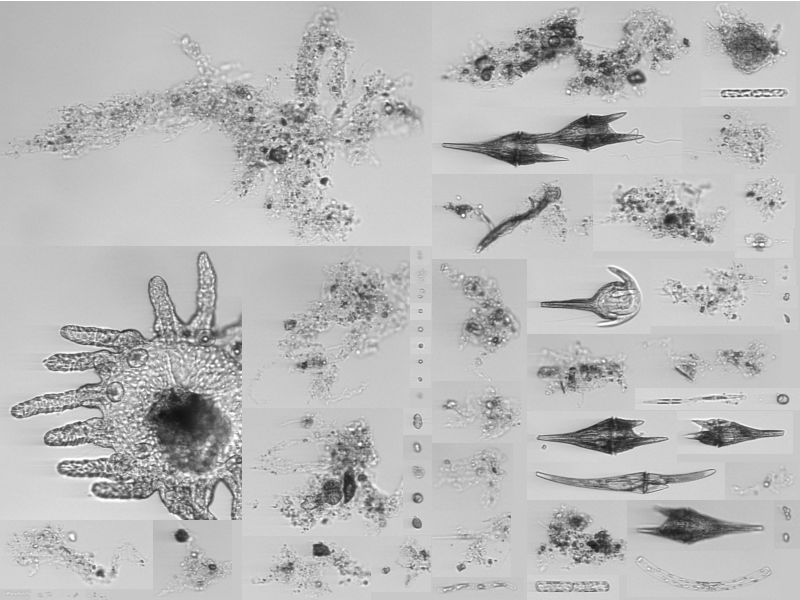

# 2026 Computer Vision Coursework
In this assignment you will expand upon your work in Labs 3 and 4 to build a multiclass image classifier from scratch. You will work with data from a challenging real-world problem: **monitoring natural populations of marine micro-organisms**. The goal is to synthesize your knowledge from the first half of the course to design an entire pipeline, from training to deployment. 



*Figure 1: A mosaic of Regions of Interest captured by the Imaging Flow CytoBot. These images of plankton are highly variable in morphology and texture.*

## Key Dates
You have one month from the assignment date to work on the project. 

| Event | Date |
|---|---|
| Coursework assigned | Oct. 26, 2026 |
| Test dataset released | Nov. 19, 2026 |
| Coursework due on KEATS | Nov. 26, 2026 |
| Feedback returned | Jan. 11, 2027 |

Please allow yourself sufficient time to work on the project; do not leave it to the last minute!

## Background
Plankton are the tiny organisms that form the base of the marine food web. They are critically important for the health and function of all ocean ecosystems. They are also exceedingly difficult to study: their lives are governed by high-dimensional physical and chemical environmental factors, forcing rapid population changes over short distances. Studying and monitoring plankton communities has historically required taking water samples with a net or bucket. Scientists have made many fascinating discoveries with these tools, but require new observation methods to resolve their complex population dynamics.

Marine ecologists began deploying imaging systems to enhance their ability to monitor these tiny creatures. The past 30 years have seen a remarkable increase in marine imaging with the advent of digital imaging sensors and cheap storage. As a result, many scientists are collecting more images then they can reasonably use: until a human assigns a taxonomic label, the images are just pretty pictures rather than usable data.

The [Imaging FlowCytobot (IFCB)](https://mclanelabs.com/imaging-flowcytobot/) is one such instrument. The IFCB is an *in situ* microscopic imaging system that draws in a water sample at set intervals, pumps particles through a microfluidic channel, and captures an image of everything that passes through. These images are automatically segmented, pulling out foreground objects and saving them as Regions of Interest (ROIs). One moored (sitting in one place) IFCB has collected several billion ROIs over 10+ years of operation. 

Your job is to develop a classifier to help sort these images. You've been given a set of expert annotated data to use for training and validation. The goal is to develop a model that works as well as possible.

## Dataset Description
There are XXX items you will download from KEATS in a ZIP file. After unzipping, you should have the following:

```
COURSEWORK_DIR/                 <-----The directory where you unpack the assignment
├——2026-coursework_env.txt      <-----The python environment requirements for the project
├——assets/                      <-----A folder containing images used in this markdown
|   └——ifcb-example-mosaic.png
├——assignment.md                <-----This markdown document
├——label_mapping.json           <-----A dictionary mapping from the organism name to a number 
├——run_model_pseudocode.py      <-----An example of how you should structure the submitted code
├——sample_submission.csv        <-----An example csv illustrating how to format test predictions
├——scoring_script.py            <-----The scoring script we'll use to run your submitted model
└——train/                       <-----The parent directory of the training data
    ├——Cerataulina
    ├——Chaetoceros
    ├——Chaetoceros_didymus_flagellate
    ├——Ciliate_mix
    ├——Corethron
    ├——Cylindrotheca
    ├——Dactyliosolen
    ├——Dinobryon
    ├——Guinardia_delicatula
    ├——Heterocapsa_triquetra
    ├——Leptocylindrus
    ├——Pseudonitzschia
    ├——Rhizosolenia
    ├——Skeletonema
    ├——Thalassiosira
    ├——detritus
    ├——dino30
    ├——mix
    ├——mix_elongated
    └——pennate
```

### Notes
* Each class has 250 ROIs to work with. It is up to you to split into training and validation.
* This is a subset of a much larger collection of images and does not reflect the natural distribution of animals. If you want to read more about why this is important check out discussions of [distribution shift](https://proceedings.mlr.press/v139/koh21a.html) and [long-tailed learning](https://ieeexplore.ieee.org/abstract/document/8579012).
* The test data will be released on KEATS one week before the deadline.
* **There is no right or best answer to this problem.** Computer Vision researchers are actively working on approaches for biodiversity monitoring. There are whole workshops at [CVPR](https://www.cv4animals.com/) and [NeurIPS](https://www.climatechange.ai/events/neurips2026) dedicated to the topic.    

## The Plan
You will need to undertake the following rough steps:

1. Split the dataset into training and validation. 
2. Write a feature extractor. This can be anything from extracting metrics like length to computing SIFT features to using "deep" features (using embeddings from a CNN or Transformer). You can check out this [2007 paper that explains an early attempt at automated classification](https://aslopubs.onlinelibrary.wiley.com/doi/epdf/10.4319/lom.2007.5.204) with this data for some inspiration. 
3. Compile the features into a feature vector. The vector can be as long as you like, but beware the [curse of dimensionality](https://towardsdatascience.com/the-math-behind-the-curse-of-dimensionality-cf8780307d74/) (basically, more features are not always better). You could try some form of [feature selection](https://scikit-learn.org/stable/modules/feature_selection.html) if you want to. 
4. Fit a classifier. You can use any model type in [scikit-learn's classification tool box](https://scikit-learn.org/stable/auto_examples/classification/index.html). There is no "best" model for this assignment. Performance will depend on the feature vector you assemble. It is worth trying a few and selecting the best one for submission.
5. Run the unlabeled test data through the classifier and save the results.

## Submission and scoring
You will be evaluated on two submissions: the predictions on the test set and a working example of your code. Overall, they will contribute to your grade as follows:

| Element | contribution to final score |
|---|---|
| Test set predictions | 40 |
| Working code example | 60 |

### Test set predictions
Classification of all files in the test set should be submitted as a CSV file called `testset_predictions.csv` following the format indicated in `sample_submission.csv`. Each line represents a single image, as indicated by the image id, and the associated numeric class output by your classifier. Each row should thus have two columns: 

```
02013389-1fd9-4282-8d9e-f7dc0d334977,17
dd1547a2-5831-46ad-9c58-addc5b86ca79,15
8a9442f7-9b31-48ad-b703-0661e3141565,18
...
```
**Do not include a header row.**

### Evaluation script 
You will submit a command line script to run your model on a directory of data. The script must read unlabeled images from a directory, compute image features, run your tuned model, and output a list predictions in the same format as above. Use the psuedo-code in `run_model_pseudocode.py` to structure your solution, taking care that the relative paths work and that the output retains the same format.  

### Submission format
You will submit a ZIP file containing the following:

```
submission.zip
├──testset_predictions.csv <-----Predictions from your model on the testset 
├──run_model.py            <-----The script to run your model
├──trained_model.pkl       <-----The model
└──feature_extractor.py    <-----Your feature extractor to be called in run_model
```

### How we will score your assignment

#### Predictions on the test set
This list will be evaluated against the true labels to compute the F1-score. **N.B. we do not anticipate a perfect or even necessarily high F1-score!** This is a hard problem and we expect a range of F1-scores. We will not use the metric as the raw score, instead scaling it against a curve calculated from all submissions. 

#### Running your evaluation script
We will run your code on a set of 100 images you will not have access to. We will compute the F1-score as a diagnostic check only. It does not contribute to marks for this section. **This portion of the assignment is entirely focused on making sure the code runs smoothly in the provided compute environment** (`coursework_env.txt`). Assume the code will be run on CPU only. Your code should run in less than 5 minutes and well-commented to help us troubleshoot any errors. You will get full marks for this section if your code runs without errors. You will lose:

* 3 points for each error message we need to address to get your code to run. Commenting your code will be helpful in case we need to do this.
* 10 points (out of the 60 allocated to the code submission) will be deducted for each minute of runtime beyond the 5-minute mark.

N.B. you can estimate run time based on the test set. We will be evaluating a factor of ten fewer samples. 

## The Rules
### Compute
There are much more powerful classification models available to train a classifier. We are restricting you to 'classical' machine learning models for two reasons:
 1. **Fairness**. Not everyone has access to the GPU-accelerated compute needed to fine tune a convolutional or attention-based image classification model. Restricting everyone to the same body of methods and models means everyone can produce something of roughly equal discriminative ability. N.B. pretrained CNN/Transformer embeddings are permitted as feature extractors, but training/fine-tuning deep networks is not.
 2. **Learning goals**. Developing a set of hand-engineered features nicely encapsulates many of the concepts from the beginning of the class.  

### Dependencies
We have provided a virtual environment in `coursework_env.txt` that you should build with `pip`, `conda`, or your package manager of choice. This is the environment we will run your evaluation script with. Do not install additional dependencies to ensure we can run your code smoothly.

### Collaboration
You are encouraged to work with your classmates on this assignment. The goal of this project is to develop intuition for how to develop an image classifier working with real data, not to test your recall. You must, however, submit your own work. **This is not a group project and we will not accept joint submissions.** We will compare across the submissions to ensure there are no direct copy/paste jobs.

### Coding Assistants
Can Claude do this for you? Yes, an LLM can definitely code this up. Will you learn anything that way? Probably not. The point of taking a class and doing the coursework is to stuggle a bit with the concepts. When you are out in the working world, you can use AI coding assistants to make your life a lot easier. But you have to build the intuition and know-how to properly scrutinize the outputs to take full advantage of their power. Use this as an opportunity to try it on your own. You have all the tools you need to succeed on this assignment without turning to AI. 